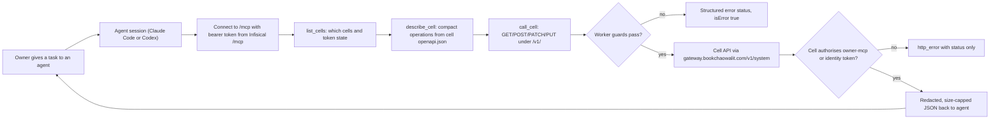

# 01 — Business process

## As-Is (จากโค้ดวันนี้)

เจ้าของใช้ AI agent (Claude Code / Codex) ทำงานกับ cell API ของ Solo Empire ทุกตัวผ่าน MCP endpoint เดียว
แทนการตั้ง MCP แยกต่อ cell ลำดับที่ agent ใช้คือ `list_cells` → `describe_cell` → `call_cell`
cell เป็นผู้ตัดสินสิทธิ์สุดท้าย Worker ทำหน้าที่ตรวจ token ของ client, จำกัด host/path/method และ redact output

Sources: README.md, PRODUCT.md, src/worker.ts (`registerCellTools`, `callCell`, `describeCell`)

กระบวนการรอง (มีมาก่อน tool hub): อ่าน health และ workspace ของ AI gateway, Agency CRM, Income CRM ผ่าน
tool แบบ fixed path (`check_remote_services`, `get_ai_status`, `get_agency_workspace`, `get_income_workspace`)

กระบวนการ ops (ผู้ดูแล = เจ้าของ): `manage.py bootstrap` สร้าง client token ครั้งแรก → `manage.py deploy`
(code + secrets) → `verify.py` smoke → `manage.py configure` ตั้ง Codex client

## To-Be

repo ไม่มี `specs/` หรือ `docs/UPGRADE-PLAN.md` สิ่งที่เขียนไว้เป็นทิศทางใน repo docs มีเท่านั้น:

- PRODUCT.md "Limits and risks": ยังไม่มี continuous uptime monitoring ที่บันทึกใน repo, Sentry ปิดจนกว่าจะตั้ง `SENTRY_DSN`
- DOCPACK/00-product-card.md ขั้นต่อไป: รัน `verify.py` / `smoke.mjs` ใหม่หลังย้าย cell

Sources: PRODUCT.md, DOCPACK/00-product-card.md

## Open questions

- To-Be process ไม่ได้นิยามไว้ใน repo: จะเปลี่ยนจาก shared bearer token เดียวเป็น per-client token/OAuth หรือไม่?
- `MCP_READONLY` ควรเปิดเป็นค่าเริ่มต้นหรือไม่ (PRODUCT.md ระบุเป็น risk แต่ไม่มีการตัดสินใจ)
