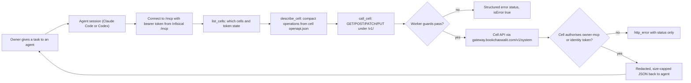

# 01 — Business process (As-Is / To-Be)

platform-mcp-remote-worker คือ Cloudflare Worker (`solo-empire-mcp-remote`) ที่เป็น MCP endpoint เดียวแบบ HTTPS ให้ agent ของ owner เรียก cell API ทุกตัวผ่าน `list_cells` → `describe_cell` → `call_cell` ด้วย bearer token เดียว โดย cell ตัดสินสิทธิ์สุดท้าย

Last reviewed: 2026-11-27 · commit `a0050cf`

## As-Is (จากโค้ดวันนี้)

เจ้าของใช้ AI agent (Claude Code / Codex) ทำงานกับ cell API ของ Solo Empire ทุกตัวผ่าน MCP endpoint เดียว
แทนการตั้ง MCP แยกต่อ cell ลำดับที่ agent ใช้คือ `list_cells` → `describe_cell` → `call_cell`
cell เป็นผู้ตัดสินสิทธิ์สุดท้าย Worker ทำหน้าที่ตรวจ token ของ client, จำกัด host/path/method และ redact output

Sources: README.md, PRODUCT.md, src/worker.ts (`registerCellTools`, `callCell`, `describeCell`)

กระบวนการรอง (มีมาก่อน tool hub): อ่าน health และ workspace ของ AI gateway, Agency CRM, Income CRM ผ่าน
tool แบบ fixed path (`check_remote_services`, `get_ai_status`, `get_agency_workspace`, `get_income_workspace`)

กระบวนการ ops (ผู้ดูแล = เจ้าของ): `manage.py bootstrap` สร้าง client token ครั้งแรก → `manage.py deploy`
(code + secrets) → `verify.py` smoke → `manage.py configure` ตั้ง Codex client

## To-Be

ไม่มี To-Be ที่เขียนไว้ (repo ไม่มี `specs/`, `docs/UPGRADE-PLAN.md` หรือ ADR ที่ระบุเป้าหมายกระบวนการ; `PRODUCT.md` "Limits and risks" ระบุความเสี่ยงที่ยังไม่ได้ตัดสิน ไม่ใช่เป้าหมาย)

Sources: `PRODUCT.md`, `DOCPACK/00-product-card.md`

## Gap

| ID | As-Is → To-Be | Status | Owner | Evidence |
|---|---|---|---|---|
| G1 | ไม่มี To-Be เขียนไว้ → owner กำหนดเป้าหมายของ tool hub | decide | owner | ขอให้ owner เขียน To-Be (spec หรือ section ใน `PRODUCT.md`) |
| G2 | shared bearer token เดียว → per-client token หรือ OAuth (ยังไม่ตัดสิน) | decide | owner | `PRODUCT.md` (Limits and risks) |
| G3 | `MCP_READONLY` ปิดเป็นค่าเริ่มต้น (`call_cell` เขียนได้) → เปิดเป็นค่าเริ่มต้นหรือไม่ | decide | owner | `PRODUCT.md` (Limits and risks); `src/worker.ts` `readOnly()` |
| G4 | ไม่มี uptime monitoring ต่อเนื่อง ตรวจเอง → monitoring ที่บันทึกใน repo | decide | owner | `PRODUCT.md` (Limits and risks) |

## Open questions

- Sentry ยังปิดจนกว่า owner ตั้ง `SENTRY_DSN` ต้องการเปิดหรือไม่
- DOCPACK/00-product-card.md (2026-10-11) ล้าสมัยกว่า `PRODUCT.md` เช่นยังบอกว่าไม่มี CI [ต้องยืนยัน] ว่าจะ refresh หรือไม่
