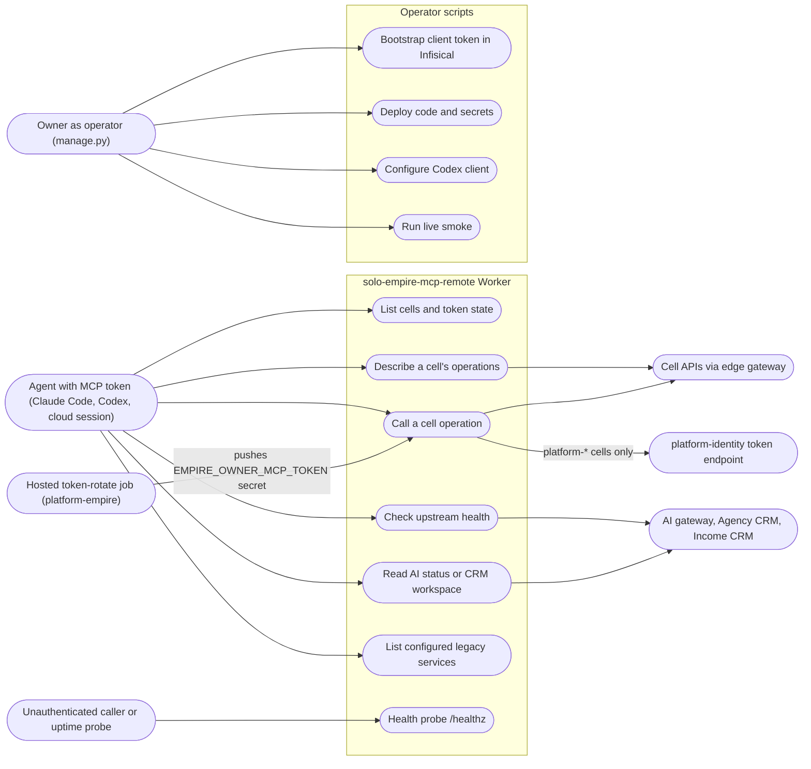

# 02 — Use cases

Actor มาจากระดับสิทธิ์จริงในโค้ด: ผู้ถือ `SOLO_MCP_REMOTE_TOKEN` (hash ใน `MCP_TOKEN_SHA256`) คือ client เดียวที่
เรียก `/mcp` ได้ ผู้ไม่มี token เรียกได้แค่ `GET /healthz` ผู้ดูแลใช้ `manage.py` กับ Cloudflare และ Infisical
ระบบภายนอกที่ Worker เรียกต่อเป็น secondary actor

Sources: src/worker.ts (`serverFor`, `registerCellTools`, `handleRequest`), manage.py (`main` actions), verify.py,
README.md (rotation job), ops record: hosted-shared-services (2026-11-03)

| Use case | Tool / entry | Guard in code |
|---|---|---|
| List cells | `list_cells` | MCP token |
| Describe cell | `describe_cell` | MCP token; GET `/openapi.json` without cell token; cache 5 min |
| Call cell | `call_cell` | MCP token; methods GET/POST/PATCH/PUT; `/v1/` path; `MCP_READONLY` |
| Upstream health | `check_remote_services` | MCP token; status only |
| Read legacy | `get_ai_status`, `get_agency_workspace`, `get_income_workspace` | MCP token + upstream read token |
| Health probe | `GET /healthz` | none; 200 only when auth + `PUBLIC_ORIGIN` configured |

## Open questions

- ไม่มี role แยกใน Worker (ทุก client ที่ถือ token ได้สิทธิ์เท่ากัน) — ตั้งใจหรือรอ per-client token?
