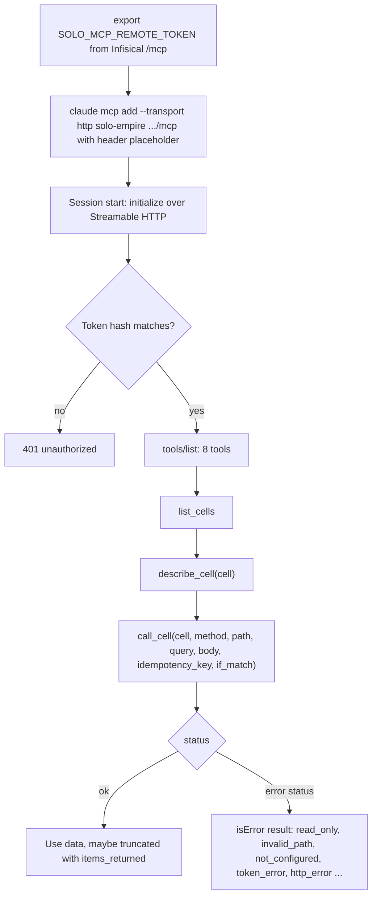
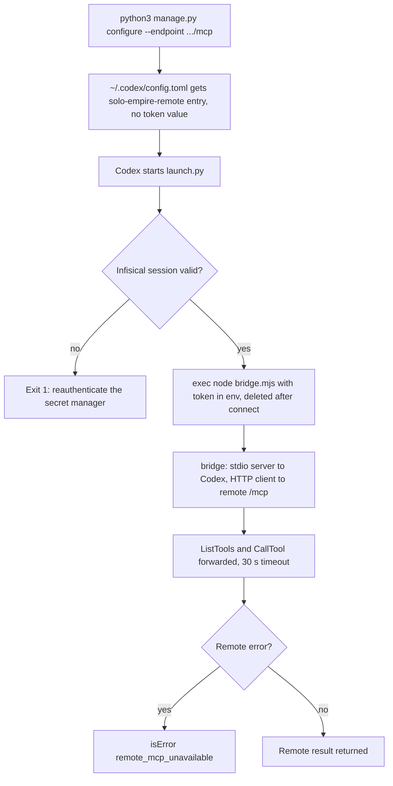
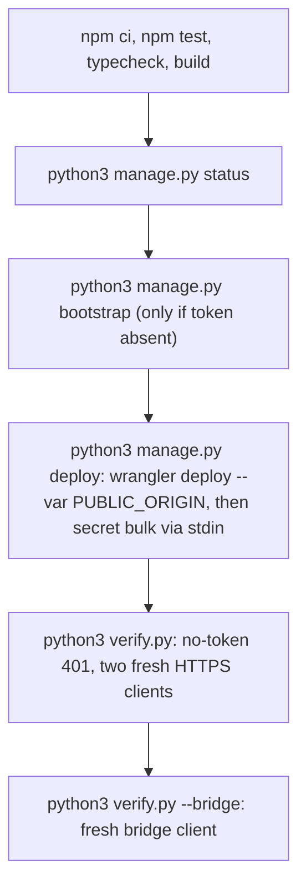

# 03 — User flows

ไม่มีหน้าเว็บ "user" คือ agent และผู้ดูแล flow ด้านล่างมาจาก route (`/mcp`, `/healthz`), tool และ script จริง

## Flow A — Claude Code (เครื่องใดก็ได้ / cloud session) ใช้ tool hub

Sources: README.md (เชื่อม agent), src/worker.ts (`handleRequest`, `toolResult`, `errorStatuses`)

## Flow B — Codex ผ่าน stdio bridge

Sources: manage.py (`configure`), launch.py, bridge.mjs

## Flow C — ผู้ดูแล deploy และตรวจ

Sources: README.md (ตรวจและ deploy), manage.py, verify.py, smoke.mjs

## Open questions

- smoke.mjs เรียกเฉพาะ `list_cells` ใน hub (ไม่เรียก `call_cell`) — การตรวจ call ต่อ cell บันทึกไว้ที่ไหนนอกจาก ops record?
