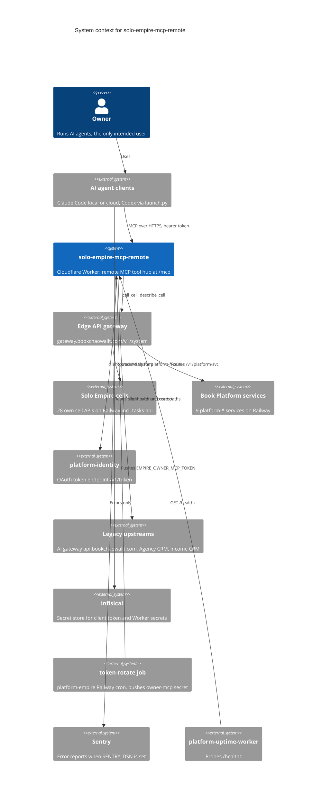

# 05 — C4 Context

Sources: wrangler.toml (`CELLS`, `[vars]` origins), src/worker.ts (`IDENTITY_ORIGIN`, `GATEWAY_ORIGIN`, `services`),
README.md (rotation, Infisical paths), src/sentry.ts, platform-uptime-worker `src/targets.ts` (target `mcp-remote`, read-only),
ops record: hosted-shared-services (2026-11-03)

หมายเหตุ: CELLS ใน wrangler.toml มี 38 entry = 29 own (28 cell + `tasks`) และ 9 `platform-*` ทั้งหมดชี้ gateway
`CELL_HOSTS` (direct Railway host) เก็บไว้เป็น rollback list

## Open questions

- cell จำนวนใน PRODUCT.md (28) และ README (27 + tasks) เก่ากว่า wrangler.toml ปัจจุบัน (38 entry) ควรอัปเดต docs หรือไม่
