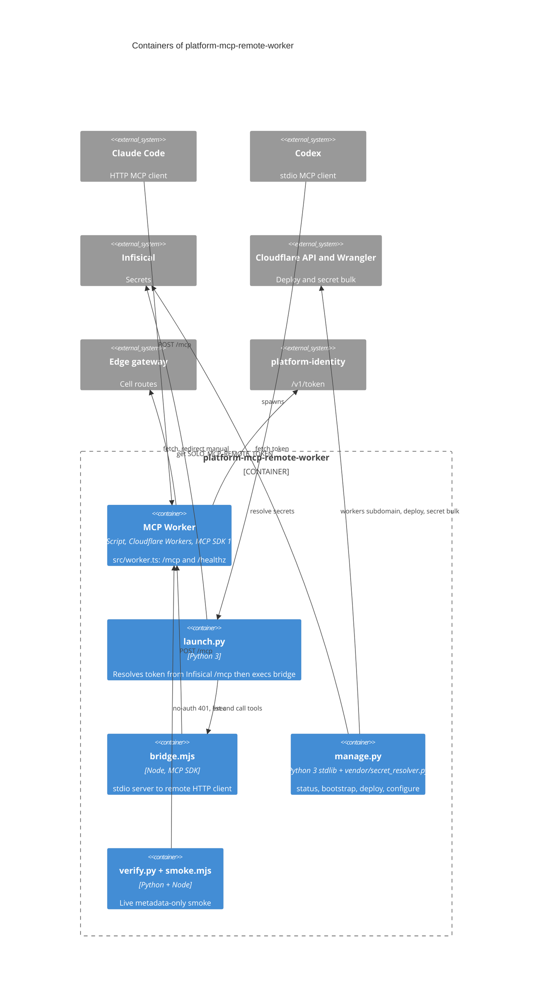

# 06 — C4 Container

Sources: package.json, src/worker.ts, launch.py, bridge.mjs, manage.py, verify.py, smoke.mjs, vendor/secret_resolver.py

Worker ไม่มี binding อื่น (ไม่มี KV/D1/R2/DO/Queue/cron ใน wrangler.toml) state เดียวคือ in-memory cache ต่อ isolate

## Open questions

- ไม่มี
