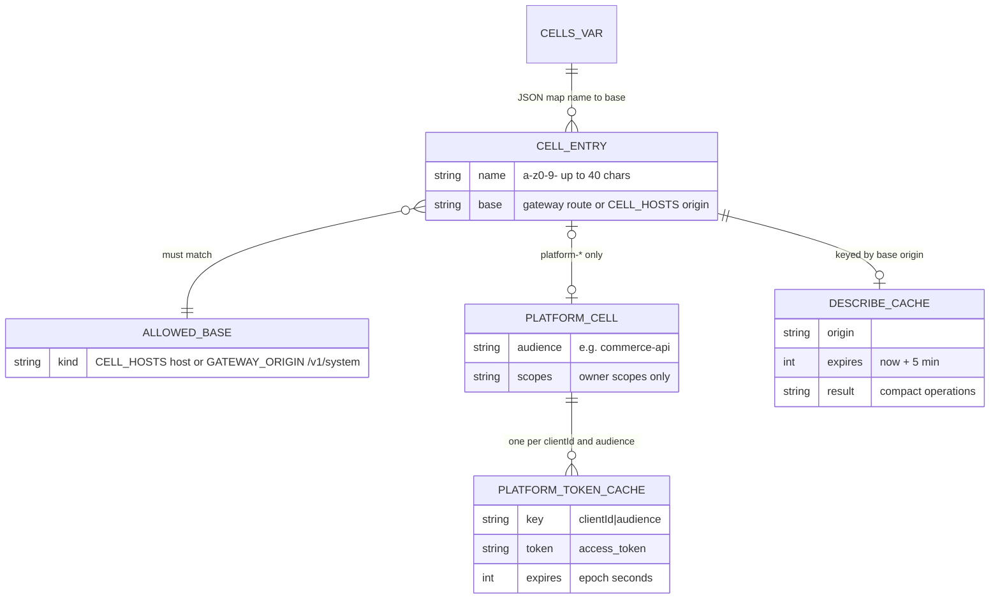

# 09 — ERD

**Status: not_applicable** — Worker ไม่มีข้อมูลที่ persist: wrangler.toml ไม่มี KV, D1, R2, Durable Object หรือ Queue binding
และ README ระบุ "บริการนี้ไม่มี storage binding, cron" ข้อมูลธุรกิจทั้งหมดอยู่ใน cell ปลายทาง (ดู ERD ของแต่ละ cell repo)

เพื่อให้เห็นรูปข้อมูลที่ Worker ถือ ด้านล่างคือ model ของ **config และ cache ใน memory ต่อ isolate** (ไม่ใช่ตารางฐานข้อมูล)

Sources: wrangler.toml, README.md, src/worker.ts (`CELLS` parsing in `cellsFrom`, `CELL_HOSTS`, `PLATFORM_CELLS`,
`platformTokens`, `describeCache`)

## Open questions

- ไม่มี
