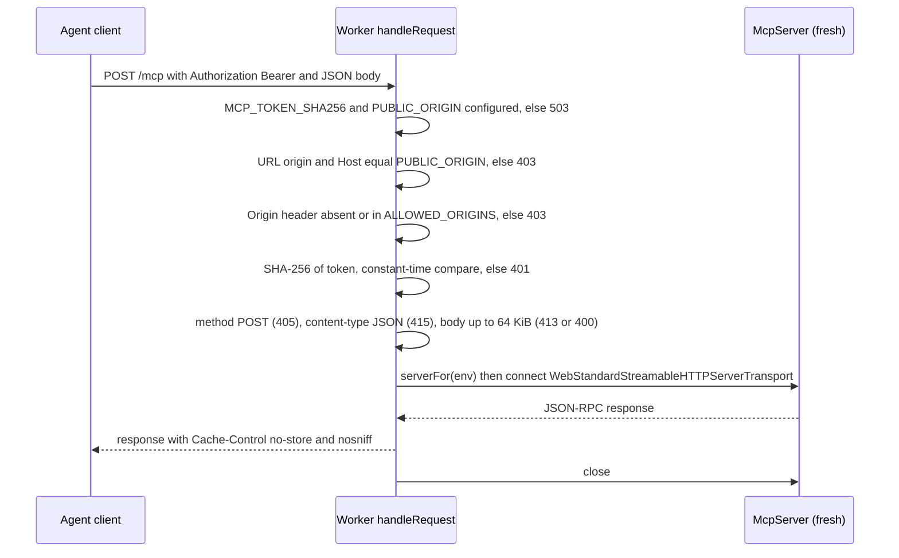
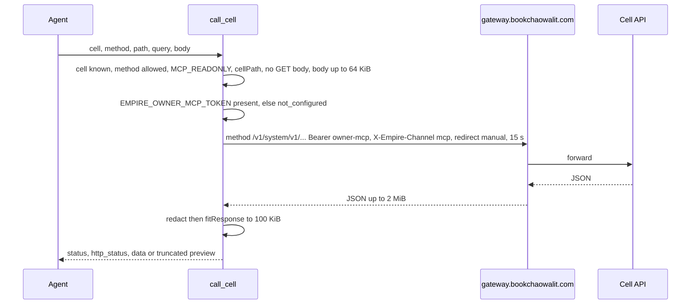
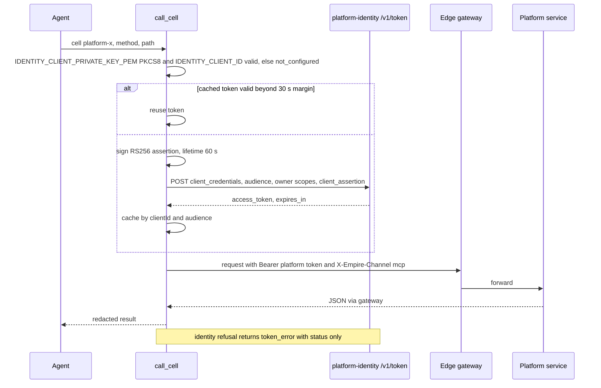
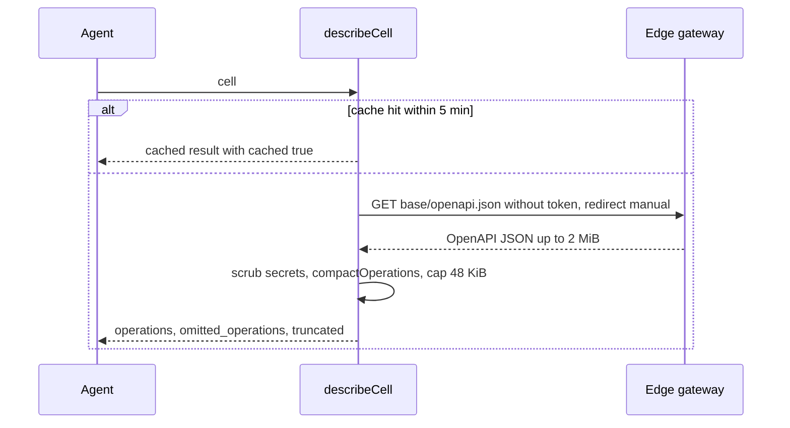

# 10 — Sequence diagrams

## S1 — MCP request: auth and transport

## S2 — call_cell to an own cell (owner-mcp)

## S3 — call_cell to a platform-* service (identity client)

## S4 — describe_cell

Sources: src/worker.ts (`handleRequest`, `authorized`, `callCell`, `platformToken`, `describeCell`, `fitResponse`),
ops record: api-gateway-edge (2026-11-03) for the gateway's tokenless openapi.json route

## Open questions

- ไม่มี
