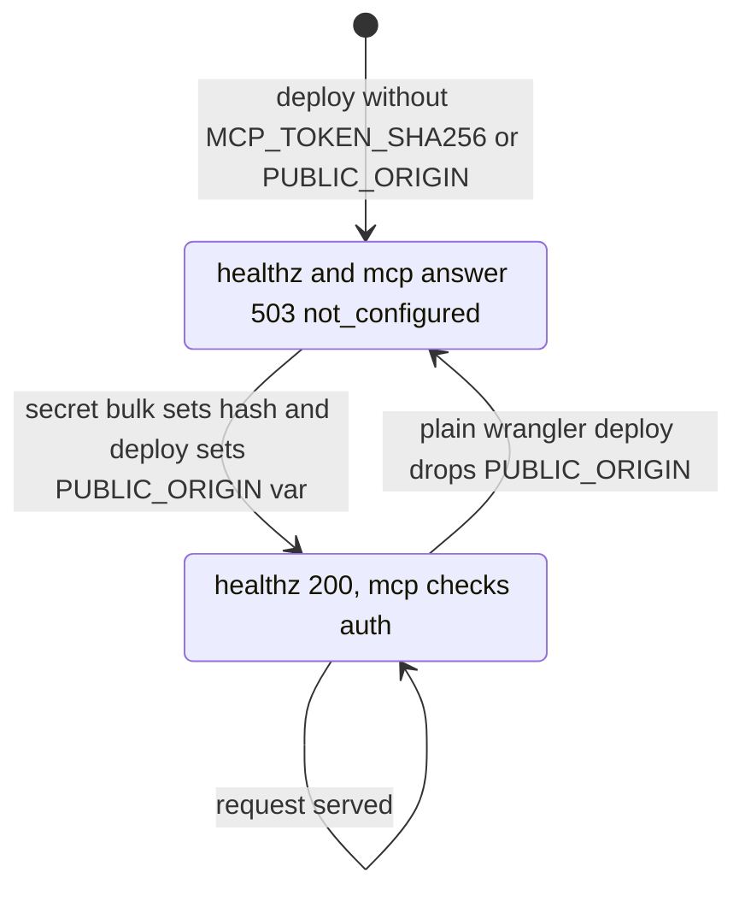
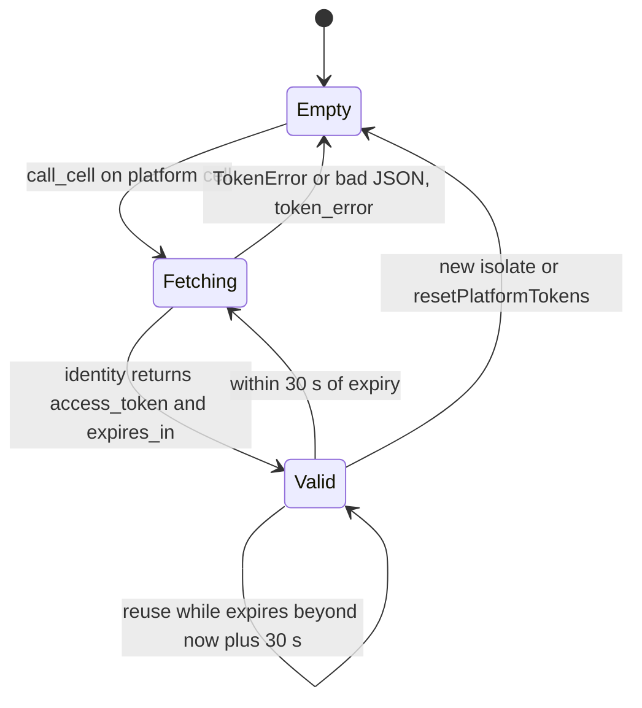
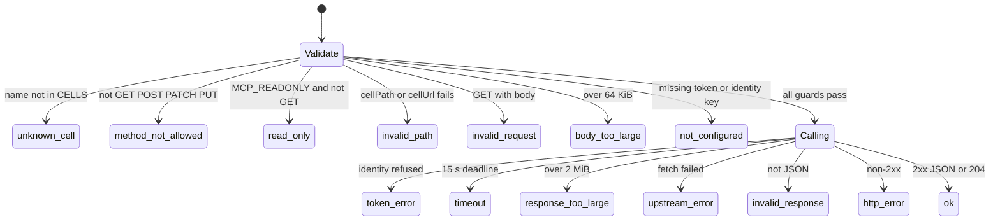

# 11 — State machines

ไม่มี entity ที่ persist พร้อม status field lifecycle ที่มีจริงในโค้ดคือ (1) readiness ของ Worker ตาม config,
(2) platform token cache ต่อ audience, (3) ผลของ `call_cell` ตามลำดับ guard

## Worker readiness

## Platform token cache (per clientId and audience, per isolate)

## call_cell result

Sources: src/worker.ts (`handleRequest` healthz, `platformToken`, `TOKEN_REFRESH_MARGIN_SECONDS`, `callCell`,
`errorStatuses`), manage.py (`deploy`), ops record: api-gateway-edge (2026-11-03) for the PUBLIC_ORIGIN drop

## Open questions

- ไม่มี
