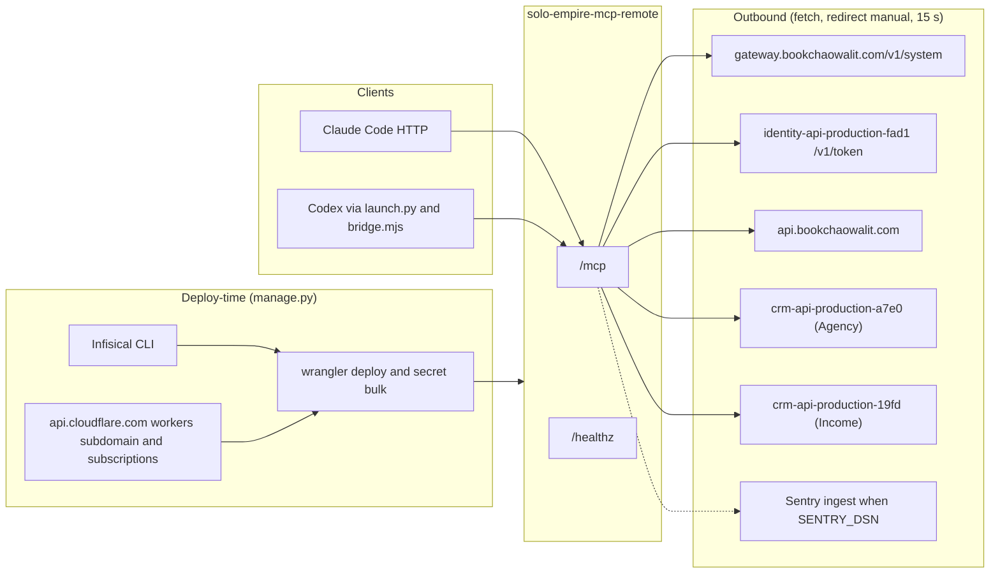

# 12 — API and integration

## Inbound endpoints

| Method | Path | Auth | Response |
|---|---|---|---|
| GET | `/healthz` | none | `200 {"status":"ok"}` when auth hash + `PUBLIC_ORIGIN` valid, else `503 not_configured` |
| POST | `/mcp` | `Authorization: Bearer <16–4096 printable>` | MCP JSON-RPC (stateless JSON mode); errors 401/403/405/413/415/400/503/500 |
| any | other | — | `404 not_found` |

## MCP tools

| Tool | Annotations | Upstream call |
|---|---|---|
| `list_remote_services` | read-only | none |
| `check_remote_services` | read-only | GET `/healthz` (AI) or `/health` (CRMs), status only |
| `get_ai_status` | read-only | GET `https://api.bookchaowalit.com/api/ai/status` with `AI_API_READ_TOKEN` |
| `get_agency_workspace` | read-only | GET Agency CRM `/api/v1/crm/agency/workspace` with `AGENCY_CRM_TOKEN` |
| `get_income_workspace` | read-only | GET Income CRM `/api/v1/crm/agency/workspace` with `INCOME_CRM_TOKEN` |
| `list_cells` | read-only | none |
| `describe_cell` | read-only | GET `<base>/openapi.json`, no token |
| `call_cell` | destructiveHint true | GET/POST/PATCH/PUT `<base>/v1/...` with owner-mcp or identity token |

## Integration flow

Cell catalogue (wrangler.toml `CELLS`, all via gateway): accounts, automation, budgets, business-assets, cash-flow,
content, decisions, diary, finance-accounts, goals, habits, health, intake, investments, learning, liabilities,
notifications, offers, operating, opportunities, projects, radar, reconciliations, roles-skills, subscriptions,
tasks (route `empire-platform`), tax, time, transactions, and platform-commerce, -communication, -data, -developer,
-logistics, -media, -payment (read only), -security, -workflow

Request headers to cells: `Accept`, `Authorization: Bearer`, `X-Empire-Channel: mcp`, optional `Content-Type`,
`Idempotency-Key`, `If-Match`

Sources: src/worker.ts, wrangler.toml, manage.py (`cf_request`, `deploy`), launch.py, bridge.mjs, src/sentry.ts

## Open questions

- Income CRM ใช้ read path `/api/v1/crm/agency/workspace` เดียวกับ Agency (บรรทัด 50 ใน src/worker.ts) — ตั้งใจหรือไม่?
