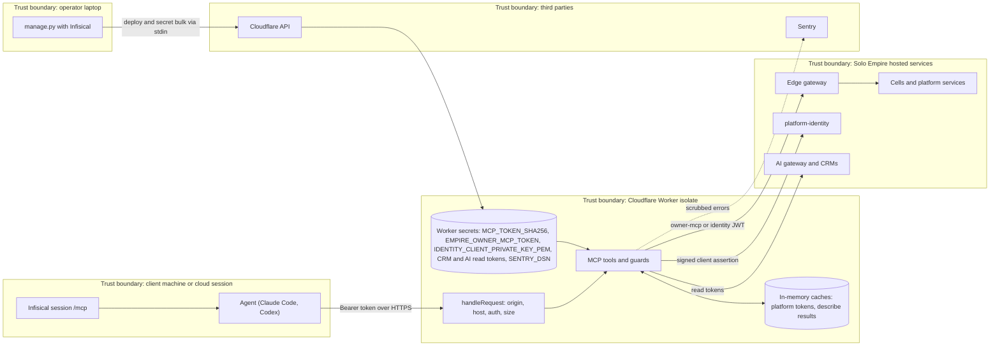

# 13 — Threat model

## DFD with trust boundaries

## STRIDE per element

| Element | Threat (STRIDE) | Mitigation in code | Gap |
|---|---|---|---|
| `/mcp` edge | S: token guessing / replay | SHA-256 compare constant-time, token regex 16–4096 chars, 48-byte random token (`secrets.token_urlsafe(48)`) | One shared token for all clients; no rate limit or lockout in Worker |
| `/mcp` edge | S/T: browser CSRF, host spoofing | Host must equal `PUBLIC_ORIGIN`, `Origin` must be in `ALLOWED_ORIGINS` (empty by default) | — |
| `/mcp` edge | D: large or slow bodies | 64 KiB streamed limit (`boundedText`), JSON only | No request rate limiting (Cloudflare plan limits only) |
| `call_cell` | E: open proxy / SSRF | `CELL_HOSTS` + exact gateway route, HTTPS only, no IP/localhost, `cellPath` blocks `..`, `%`, `//`, query; `redirect: manual` | — |
| `call_cell` | T: unwanted writes | No DELETE; `MCP_READONLY`; payment read-only scopes; `destructiveHint: true` | Writes allowed by default (PRODUCT.md risk) |
| `call_cell` / `describe_cell` | I: secret leakage in output | `redact` keys and values, `scrub` before clipping, `dropSecretPrefix`, fetch errors not forwarded | — |
| Worker secrets | I: leaked via deploy logs | `fixed_command` hides stdout/stderr; secrets via stdin; client token stored only as hash | — |
| Platform token | E: excess scope | Owner scopes only; no `jobs:work`, `quotas:*`, `audit:write`; assertion lifetime 60 s, `jti` | Key is long-lived PKCS#8 secret; rotation of `mcp-hub` key not described in repo |
| owner-mcp token | S: stale or stolen | Rotated weekly by hosted job; cells decide authz; channel header `mcp` | Rotation lives outside this repo |
| Sentry | I: PII / tokens in events | `scrubEvent` deletes request, extra, user, breadcrumbs; redacts bearer and key=value; no tracing | — |
| Codex bridge | I: token on disk | `launch.py` resolves at start; `bridge.mjs` deletes env var after connect; config holds no value | Token lives in process memory of the bridge |
| Upstreams | R: no audit trail in hub | Cells see `X-Empire-Channel: mcp` | Worker itself writes no audit log of tool calls |
| CI | T: supply chain | gitleaks, semgrep, osv-scanner, trivy-fs; SHA-pinned reusable workflows; renovate | — |

Sources: src/worker.ts, src/sentry.ts, manage.py, launch.py, bridge.mjs, README.md (Security model), PRODUCT.md (Limits and risks),
.github/workflows/ci.yml, renovate.json

## Open questions

- ควรมี rate limit (Cloudflare rule หรือในโค้ด) บน `/mcp` หรือไม่
- นโยบาย rotation ของ `SOLO_MCP_REMOTE_TOKEN` และ key ของ identity client `mcp-hub` ไม่มีใน repo
- ต้องการ audit log ของ tool call ฝั่ง hub หรือพอใจกับ audit ที่ cell
