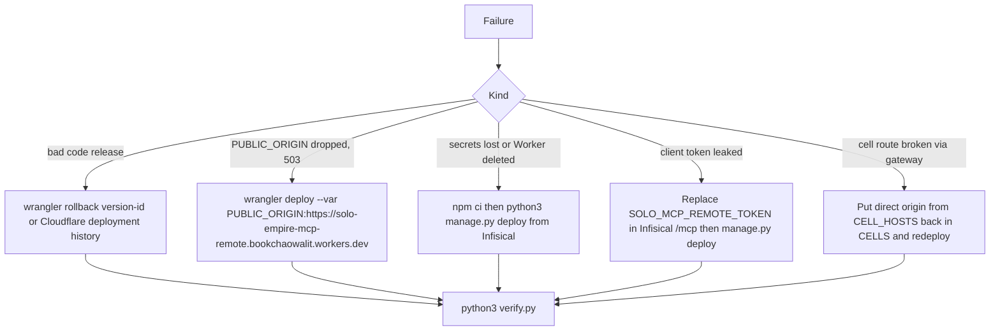

# 14 — Backup and DR

## ข้อมูลที่มีและที่อยู่

| ข้อมูล | ที่อยู่ | Backup จริง |
|---|---|---|
| Worker code | GitHub `bookchaowalit/platform-mcp-remote-worker` (public) | git; Cloudflare เก็บ deployment history |
| Worker config (`[vars]`, `CELLS`) | wrangler.toml ใน git | git |
| Client token `SOLO_MCP_REMOTE_TOKEN` | Infisical `/mcp` | ตาม Infisical (ไม่มีขั้นตอนใน repo) |
| Worker secrets | Cloudflare Worker secrets (ส่งจาก Infisical `/mcp`, `/ai-gateway`, `/crm`, `/income`, `/mcp-hub`, `/empire-platform`) | สร้างใหม่ได้ด้วย `manage.py deploy` |
| owner-mcp token | push โดย token-rotate job | re-mint โดย rotation job |
| Business data | ไม่มีใน Worker (อยู่ใน cell) | ดู backup ของ cell |
| Cache ใน isolate | memory | ไม่ต้อง backup (สร้างใหม่อัตโนมัติ) |

## Recovery flow

Sources: README.md (Rollback, ตรวจและ deploy), PRODUCT.md (How it runs and deploys), manage.py (`deploy`, `worker_secrets`, `bootstrap`),
wrangler.toml (rollback comment), ops record: api-gateway-edge (2026-11-03)

RTO / RPO: not defined (ไม่มีใน repo) RPO ในทางปฏิบัติไม่เกี่ยวเพราะไม่มีข้อมูล persist

## Open questions

- `manage.py bootstrap` ไม่ทับ token ที่มีอยู่ — ขั้นตอน rotate client token ที่ตั้งใจคืออะไร (ลบใน Infisical แล้ว bootstrap?)
- RTO เป้าหมายของ hub
