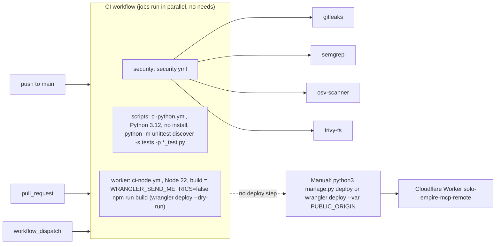

# 15 — CI/CD pipeline

workflow เดียว `.github/workflows/ci.yml` (`name: CI`) เรียก reusable workflows ของ `bookchaowalit/platform-ci-workflows`
pin ที่ SHA `c37ef9d1…` (v1.0.1) บน GitHub-hosted runner (repo public) `permissions: contents: read`,
concurrency `ci-<ref>` cancel-in-progress **CI ไม่ deploy** — deploy เป็นขั้นมือแยก

job names ที่เห็นใน run จริง: `worker / node (.)`, `scripts / python (.)`, `security / gitleaks`, `security / semgrep`,
`security / osv-scanner`, `security / trivy-fs` (`gh run view 41604145728 --json jobs`)

สถานะ ณ 2026-11-03: main `0a0e32d` และ `321b8a5` แดงที่ `scripts / python (.)` — log แสดง diff ของการจัดรูปแบบ
(`manage.py` บรรทัด identity client และ `tests/manage_test.py` `assertEqual`) จึงน่าจะเป็น format check ใน reusable
workflow ไม่ใช่ unittest fail ส่วน job อื่นเขียวทั้งหมด

Sources: .github/workflows/ci.yml, package.json (`build`, `test`, `typecheck`), ruff.toml, renovate.json,
`gh run list --branch main`, `gh run view 41604145728 --log-failed`

## Open questions

- ci-node.yml รัน `npm test` และ `npm run typecheck` ด้วยหรือไม่ (อยู่ใน reusable workflow ที่ไม่ได้อ่านในงานนี้)
- ใครจะแก้ format ของ `manage.py` / `tests/manage_test.py` ให้ main กลับเขียว
