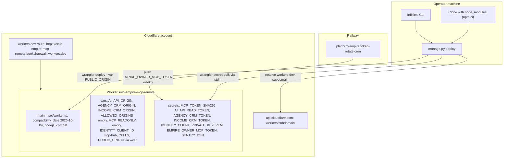

# 16 — Deployment

- Hosting: Cloudflare Workers, `workers_dev = true` ไม่มี custom domain หรือ `routes` ใน wrangler.toml
- Bindings: มีเฉพาะ vars และ secrets (ไม่มี KV/D1/R2/DO/Queue/cron triggers)
- Environments: production เดียว (ไม่มี `[env.*]`); Infisical environment default `dev` ใน `manage.py bootstrap`
- Code-only redeploy: `wrangler deploy --var PUBLIC_ORIGIN:<origin>` พร้อม Cloudflare credentials จาก Infisical `/cloudflare` (PRODUCT.md)

Sources: wrangler.toml, manage.py (`public_origin`, `deploy`, `worker_secrets`), src/worker.ts (`Env`), PRODUCT.md,
README.md, ops record: hosted-shared-services (2026-11-03), ops record: api-gateway-edge (2026-11-03)

## Open questions

- `SENTRY_DSN` ถูกตั้งบน Worker แล้วหรือยัง (PRODUCT.md 2026-10-23 บอกยังปิด; `manage.py` ไม่ส่งค่านี้)
- ต้องการ custom domain แทน workers.dev หรือไม่
