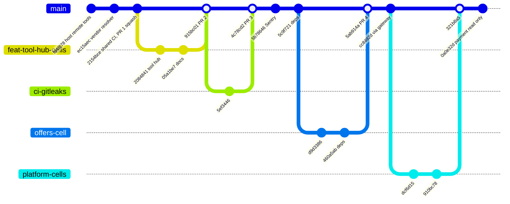
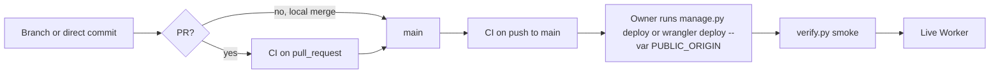

# 18 — Git and release workflow

จาก `git log --graph`: งานเข้าทาง feature branch แล้ว merge เข้า `main` (PR #1 (squash) และ #2–#4 (merge commit) บน GitHub และ merge local เช่น
`321b8a5 Merge branch platform-cells`) รวมถึง commit ตรงบน main (เช่น `cc8492d`, `0a0e32d`) ไม่มี tag หรือ release
version ใน git (`package.json` version 1.0.0 ตายตัว) การ release = deploy มือหลัง CI

หมายเหตุ: deploy ไม่ได้ถูก gate โดย CI ทางเทคนิค (เป็นขั้นมือ) — main `321b8a5` และ `0a0e32d` ถูกใช้ live ตาม ops record
ขณะ CI แดงที่ `scripts`

Sources: `git log --graph --oneline origin/main`, `gh pr list --state all`, .github/workflows/ci.yml, PRODUCT.md,
ops record: book-platforms-status (2026-11-03)

## Open questions

- ควรบังคับ "CI green ก่อน deploy" (เช่น script ตรวจ `gh run` ใน `manage.py`) หรือไม่
- ไม่มี branch protection ที่ตรวจได้จาก repo files
