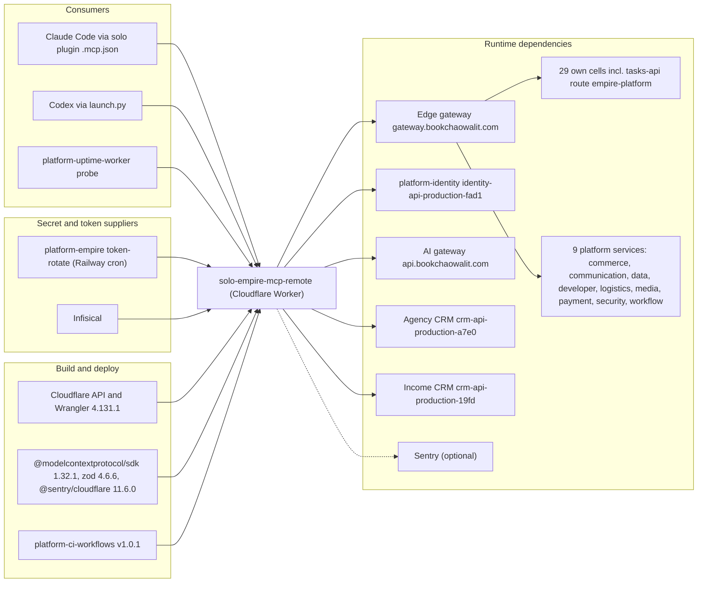

# 19 — Service dependency map

Sources: wrangler.toml, src/worker.ts (`CELL_HOSTS`, `IDENTITY_ORIGIN`, `services`), package.json, .github/workflows/ci.yml,
manage.py, launch.py, platform-uptime-worker `src/targets.ts` (read-only), ops record: hosted-shared-services (2026-11-03)

Failure impact: gateway down → `call_cell` / `describe_cell` ทุก cell ล้ม (rollback = direct origin ใน `CELLS`);
identity down → เฉพาะ `platform-*` ได้ `token_error`; rotation ไม่ push → owner-mcp หมดอายุ → own cells `http_error` 401

## Open questions

- ไม่มี
