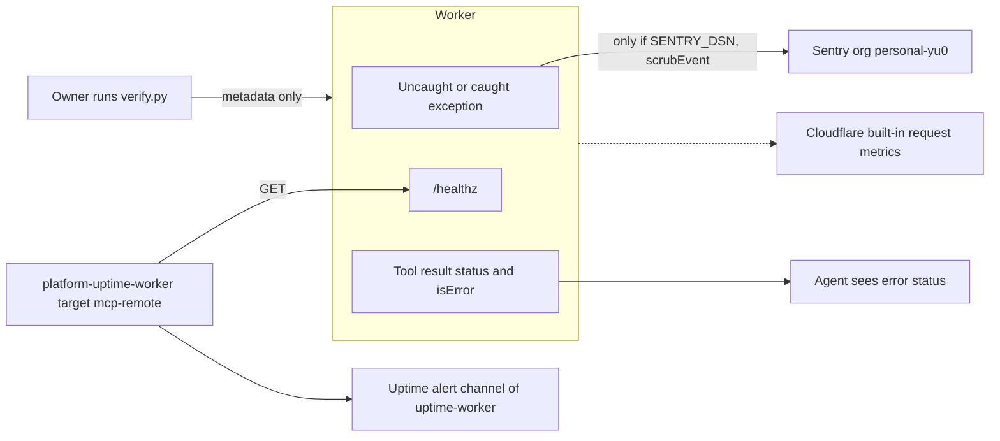

# 20 — Observability

สัญญาณที่มีจริง:

1. **Sentry** (`@sentry/cloudflare`, `Sentry.withSentry` + `captureException` ใน catch ของ `handleRequest`) — ทำงานเฉพาะเมื่อมี
   secret `SENTRY_DSN`; errors only, ไม่มี tracing/breadcrumbs/trace headers; `scrubEvent` ลบ request/extra/user
2. **Uptime probe** — platform-uptime-worker มี target `mcp-remote` → `GET /healthz` (group `own`)
3. **Live smoke** — `verify.py` / `smoke.mjs` รันมือ พิมพ์ metadata เท่านั้น
4. **Tool result status** — ทุก tool คืน `status` + `isError` (ฝั่ง client เห็น ไม่ได้ส่งไปที่ใด)
5. **Cloudflare Workers logs/metrics** — มีโดย platform; repo ไม่เปิด `observability` ใน wrangler.toml และโค้ดไม่ `console.log`

Watched: readiness ของ `/healthz` (ไม่ได้ตรวจว่า upstream/cell ใช้ได้), error ของ Worker (เมื่อเปิด Sentry)
ไม่ watch: latency, error rate ต่อ cell, การหมดอายุของ owner-mcp token (เห็นได้จาก `token_configured` ใน `list_cells` เท่านั้น)

Sources: src/worker.ts, src/sentry.ts, README.md (Sentry), PRODUCT.md, wrangler.toml, smoke.mjs, verify.py,
platform-uptime-worker `src/targets.ts` (read-only)

## Open questions

- `SENTRY_DSN` ตั้งแล้วหรือยัง
- uptime-worker ส่ง alert ไปช่องทางไหนสำหรับ target นี้ (อยู่นอก repo นี้)
- ต้องการ heartbeat หรือ synthetic `call_cell` ตามรอบหรือไม่
