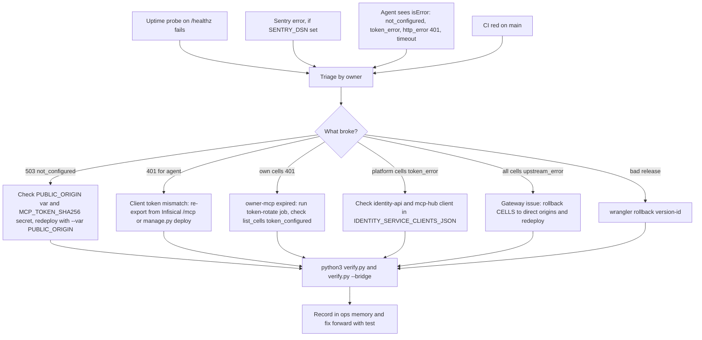

# 21 — Incident response

repo ไม่มี runbook หรือ postmortem template flow ด้านล่างประกอบจาก alert/check ที่มีจริงและขั้น rollback ที่ README / PRODUCT.md
ระบุ ตัวอย่างจริง: 2026-11-03 `wrangler deploy` ธรรมดาทำให้ `PUBLIC_ORIGIN` หาย `/mcp` ตอบ 503 และแก้ภายในไม่กี่นาที
(ops record: api-gateway-edge)

Sources: README.md (Rollback, Security model), PRODUCT.md, src/worker.ts (status values), wrangler.toml (rollback comment),
ops record: api-gateway-edge (2026-11-03), ops record: book-platforms-status (2026-11-03), ops record: hosted-shared-services (2026-11-03)

## Open questions

- ไม่มี postmortem template หรือที่เก็บ incident record สำหรับ repo นี้
- severity / on-call ไม่ได้นิยาม (single owner)
