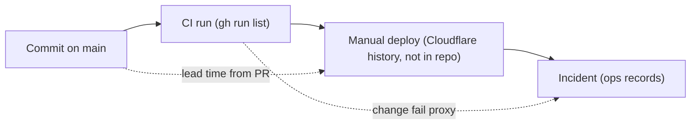

# 22 — DORA metrics

ช่วงวัด: 90 วันถึง 2026-11-03 (repo เริ่ม 2026-10-04) Deploy เป็นขั้นมือที่ไม่ทิ้งร่องรอยใน git/GitHub จึงใช้ proxy ที่ระบุชัด

| Metric | วิธีวัดสำหรับ repo นี้ | ค่าปัจจุบัน | คำสั่ง |
|---|---|---|---|
| Deployment frequency | ควรนับจาก Cloudflare deployment history ของ `solo-empire-mcp-remote`; proxy = จำนวนการเปลี่ยนบน main (first-parent) | **ไม่สามารถคำนวณจาก git/gh** — proxy: 15 first-parent commits บน main / 90 วัน (กระจุก 8 วันที่ต่างกัน) | `git log --first-parent origin/main --since="90 days ago" --oneline \| wc -l` |
| Lead time for changes | PR created → merged (deploy ทำมือหลัง merge, ไม่มี timestamp) | PR #1 15 นาที, #2 42 นาที, #3 1 นาที, #4 9 นาที (median ≈ 12 นาที) | `gh pr list --state all --json number,createdAt,mergedAt` |
| Change fail rate | proxy = CI run บน main ที่ fail / ทั้งหมด (ไม่ใช่ deploy fail) | 4 / 9 runs บน main (≈ 44%): `0a0e32d`, `321b8a5`, `5b78646`, `915bc01` | `gh run list --branch main --limit 100 --json conclusion,headSha` |
| Failed deployment recovery time | จาก ops record / incident | 1 incident ที่รู้: 2026-11-03 PUBLIC_ORIGIN หายหลัง plain deploy, แก้ "within minutes"; ไม่มี timestamp ที่วัดได้ | ops record: api-gateway-edge (2026-11-03) |
| Deployment rework rate | proxy = commit `fix*` / non-merge commits ใน 90 วัน | 5 / 25 (20%) | `git log --since="90 days ago" --oneline --no-merges \| wc -l` และ `git log --since="90 days ago" --oneline \| grep -c -E "^[0-9a-f]+ fix"` |

ภาพรวม CI ทั้งหมด (ทุก branch, 90 วัน): success 10, failure 9 (`gh run list --limit 100 --created ">=2026-08-05" --json conclusion`)

Sources: `git log`, `gh run list`, `gh pr list` (run 2026-11-03 on `origin/main` `0a0e32d`), ops record: api-gateway-edge (2026-11-03)

## Open questions

- อนุญาตให้อ่าน `wrangler deployments list` (ต้องใช้ Cloudflare credentials) เพื่อวัด deployment frequency จริงหรือไม่
- CI fail 4/9 ส่วนใหญ่เป็น lint/format/gitleaks ไม่ใช่ production fail — ต้องการ definition ของ "failed change" สำหรับ hub
